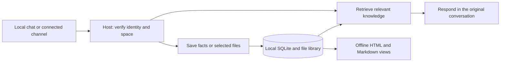

# Koder Personal Knowledge

English | [简体中文](README.zh-CN.md) · **v1.0.0**


**Keep an agent’s notes and reference files in a local library—look up a preference, find a source document, or correct an old fact without loading every past conversation.**

Built by [KarmenLoop](https://github.com/KarmenLoop) for [Koder](https://karmenloop.com). The package includes a portable skill and a small Python tool that other agent hosts can use. Storage makes **no network requests**; a host may still send retrieved excerpts to its configured model.

[Releases](https://github.com/KarmenLoop/koder-personal-knowledge/releases) · [Tutorial](docs/tutorial.en.md) · [中文教程](docs/tutorial.zh-CN.md) · [Documentation](#documentation) · [Contributing](CONTRIBUTING.md) · [License](LICENSE)

---

## Why this exists

Long chats bury preferences and blur sources. Agents either forget lasting facts or dump entire histories into the model window. Personal Knowledge keeps **inspectable local records** with provenance, bounded retrieval, corrections with history, and optional shared spaces—without claiming cloud sync or built-in messaging logins.

---

## Snapshot

| | |
| --- | --- |
| **What you install** | Full `koder-personal-knowledge/` skill folder + bundled `knowledge.py` tool |
| **Version** | **1.0.0** (`VERSION`) |
| **Runtime** | Python **3.9+** with standard `sqlite3`; no third-party packages |
| **Storage** | Local SQLite + managed file copies + offline HTML/Markdown/JSON views |
| **Network (tool)** | **None** from the storage script |
| **License** | [MIT](LICENSE) |
| **Not in this release** | Cloud sync, multi-computer write protocol, built-in PDF/OCR engines, WeChat/Feishu login adapters |

---

## Is / Is not

| Is | Is not |
| --- | --- |
| Local personal knowledge library for agents | Hosted chatbot or model fine-tuning |
| Bounded search over notes and selected files | Dumping the whole library into every prompt |
| Corrections with superseded history; forget with tombstones | Physical secure erase of SSDs or cloud provider logs |
| Shared spaces with verified principals (host-mediated) | Matching display names across apps as identity |
| Offline HTML / Markdown / JSON inspection | Public export meant for unrestricted sharing |
| Portable skill + stdlib Python tool | Desktop installer, channel login service, or vector search |

---

## Capabilities

| Capability | What you get |
| --- | --- |
| Learn as you talk | Save explicit, lasting preferences and facts without a lengthy setup interview |
| Personal context | Profile, habits, relationships, tools, work, industry terms, everyday details |
| Reference library | Selected files with original names, source refs, SHA-256 |
| Focused retrieval | Bounded excerpts instead of the whole library |
| Facts and inferences | Behavioral inferences stay unconfirmed until verified |
| Corrections with history | Replace a fact; mark the earlier record superseded |
| Inspectable storage | Local HTML, per-record Markdown, full JSON catalog |
| Shared spaces | Owner grants read or contribute access to a verified user/group |
| Reliable local writes | SQLite transactions, atomic replacement, event dedup, bounded lock waits |
| Forgetting | Remove records and unused copies; block deleted events from retry restore |

**Eight categories, one library:** personal profile · habits and preferences · people and relationships · tools · work and career · industry knowledge · everyday life · reference library. An empty library is ready to use.



---

## Quickstart

Requirements: **Python 3.9+**. Download the skill ZIP from [Releases](https://github.com/KarmenLoop/koder-personal-knowledge/releases), or:

```sh
git clone https://github.com/KarmenLoop/koder-personal-knowledge.git
cd koder-personal-knowledge
```

Keep the complete `koder-personal-knowledge/` folder. Example walkthrough (isolated demo root; use a verified owner ID in production):

```sh
python3 koder-personal-knowledge/scripts/knowledge.py path
python3 koder-personal-knowledge/scripts/knowledge.py \
  --root ./demo-knowledge init --owner local-owner
python3 koder-personal-knowledge/scripts/knowledge.py \
  --root ./demo-knowledge --principal local-owner \
  remember --record examples/preference.json
python3 koder-personal-knowledge/scripts/knowledge.py \
  --root ./demo-knowledge --principal local-owner \
  search "summary" --max-chars 2000
python3 koder-personal-knowledge/scripts/knowledge.py \
  --root ./demo-knowledge --principal local-owner \
  import-file --file examples/field-notes.txt --source examples/file-source.json
python3 koder-personal-knowledge/scripts/knowledge.py \
  --root ./demo-knowledge --principal local-owner render
```

Open `demo-knowledge/views/index.html` offline on the owner’s computer. Full install, host wiring, channels, update, and removal: [tutorial](docs/tutorial.en.md).

### Default storage locations

| Platform | Default root |
| --- | --- |
| Windows with D: | `D:\KoderKnowledge` |
| Windows without D: | `KoderKnowledge` under the user profile (or `C:\Users\<username>\KoderKnowledge` if redirected) |
| macOS / Linux | `~/KoderKnowledge` |

Use `--root` or `KODER_KNOWLEDGE_ROOT`. Switching path does not migrate an existing library.

---

## Connected channels and documents (brief)

A running host can serve multiple connected apps from one local library. The host authenticates messages and maps linked accounts to a verified principal. `reader` retrieves; `writer` may add records and imports; only the owner changes grants, deletes, supersedes, or renders the full library. Knowledge access does **not** grant computer-task or new-recipient file-send authority.

UTF-8 / GB18030 text can be indexed directly. PDFs, Office, and images can be archived; searchable text needs a host parser or OCR. `attachment_only` means the original is saved but contents were not extracted. Default limits: 32 MiB per original, 256K characters per record. Retrieval uses keywords and Chinese fragments—**no vector search**.

Read [privacy](docs/privacy.md) before connecting a hosted model or shared channel.

---

## Documentation

| Guide | Start here when you want to… |
| --- | --- |
| [Tutorial (EN)](docs/tutorial.en.md) · [中文](docs/tutorial.zh-CN.md) | Download, first save/search, troubleshoot, update, remove |
| [Skill instructions](koder-personal-knowledge/SKILL.md) | How an agent should learn and retrieve |
| [Command reference](koder-personal-knowledge/references/commands.md) | CLI, corrections, sharing |
| [Host integration](koder-personal-knowledge/references/host-integration.md) | Agent or messaging gateway inputs |
| [Architecture](docs/architecture.md) | Storage and data flow |
| [Privacy](docs/privacy.md) | Local storage, model exposure, deletion |
| [FAQ](docs/faq.md) | Setup questions and limits |
| [Validation](docs/validation.md) | What has and has not been verified |

---

## Project status

Local storage and retrieval are implemented. The local suite passes **27 tests on macOS**, including concurrent subprocess writes ([validation](docs/validation.md)). Native Windows/Linux behavior, live channel round trips, automatic host invocation, and external PDF/Office/OCR extraction need separate validation. There is **no** cloud synchronization layer or multi-computer write protocol in this release.

```sh
python3 -B -m unittest discover -s tests -v
```

---

## FAQ

### Is this a chatbot or a model?

No. It is a portable skill plus a local knowledge tool. The host provides the model, UI, identity, and any messaging connections.

### Does it change model weights?

No. Learning means inspectable records and later retrieval.

### Can my phone use knowledge on my computer?

Through a **running** host and an already-connected channel adapter—yes. This repo does not provide remote access or app login by itself.

### Does it sync across computers?

Not in this release. Do not rely on ordinary cloud-folder sync for a SQLite database written on multiple machines.

### Soft discoverability

Useful phrases: **local personal knowledge base for agents**, **SQLite notes and reference library**, **bounded retrieval instead of full chat history**, **correctable agent memory with provenance**, **shared knowledge space with verified principals**. Avoid stuffing; substance is in the skill, tool, and privacy docs.

---

## License and contact

[MIT](LICENSE). Keep [NOTICE](NOTICE). Examples and tests use synthetic people, events, messages, and files.

Issues: [GitHub Issues](https://github.com/KarmenLoop/koder-personal-knowledge/issues) · [SUPPORT.md](SUPPORT.md) · [SECURITY.md](SECURITY.md). Keep personal knowledge files and credentials out of public issues.
