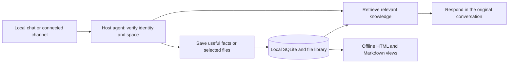

# Koder Personal Knowledge

Koder Personal Knowledge keeps an agent's notes and reference files in a local library. The agent can look up a preference, find a source document, or correct an old fact without loading every past conversation.

Built by [KarmenLoop](https://github.com/KarmenLoop) for Koder. The package includes a portable skill and a small Python tool that other agent hosts can use.


[Releases](https://github.com/KarmenLoop/koder-personal-knowledge/releases) · [Quick start](#quick-start) · [Capabilities](#capabilities) · [Documentation](#documentation) · [Contributing](CONTRIBUTING.md) · [License](LICENSE) · [Support](SUPPORT.md)

## Overview

The library stores small records with their sources, plus copies of files you choose to add. Search returns a few relevant excerpts. You can browse the records, correct them, archive a file, or ask the agent to forget something.

Several channels can use one library on the same computer if the host already supports them. For example, a host with WeChat or Feishu/Lark connections can give those conversations access to a verified space. The host handles account binding and message delivery; this project handles the notes and reference library.

The storage tool makes no network requests. A host agent may send retrieved excerpts to its configured model provider. Read [Privacy and data handling](docs/privacy.md) before connecting a hosted model or a shared channel.

## Capabilities

| Capability | What you get |
| --- | --- |
| Learn as you talk | Save explicit, lasting preferences and facts without a lengthy setup interview. |
| Personal context | Keep a profile, habits, relationships, tools, work, industry terms, and everyday details. |
| Reference library | Copy selected files into a managed library with their original names, source references, and SHA-256 hashes. |
| Focused retrieval | Search local text and return bounded excerpts instead of sending the whole library to a model. |
| Facts and inferences | Keep behavioral inferences unconfirmed until the user verifies them. |
| Corrections with history | Replace an outdated fact while retaining its source and marking the earlier record as superseded. |
| Inspectable storage | Browse a local HTML page, per-record Markdown files, or a complete JSON catalog. |
| Shared spaces | Let the owner grant a verified user or group read or contribution access to a space. |
| Reliable local writes | Use SQLite transactions, atomic file replacement, event deduplication, and bounded lock waits. |
| Forgetting | Remove records and unused file copies, refresh the views, and block a deleted event from reappearing through a retry. |

### Eight categories, one library

- **Personal profile** — facts the user has shared about themselves.
- **Habits and preferences** — communication style, routines, and working preferences.
- **People and relationships** — people the user has identified and the relationships they have described.
- **Tools** — applications and workflows the user prefers.
- **Work and career** — responsibilities, projects, and professional context.
- **Industry knowledge** — vocabulary, definitions, and domain reference material.
- **Everyday life** — day-to-day details the user wants the agent to remember.
- **Reference library** — files and documents with traceable sources.

An empty library is ready to use. It does not need to be "finished" before retrieval works.

## How it works



Each record retains its source, speaker when available, creation time, and status. The host decides which conversation belongs to which principal and space. Matching display names across apps is not enough to link identities.

The skill describes when an agent should retrieve or save knowledge. Automatic invocation depends on the host's skill selection and message processing. Importing a Markdown file alone does not create a background worker or connect a messaging account.

## Download and install

Download the installable skill ZIP from [Releases](https://github.com/KarmenLoop/koder-personal-knowledge/releases). For the full source and tests, use **Code → Download ZIP** or clone the repository:

```sh
git clone https://github.com/KarmenLoop/koder-personal-knowledge.git
cd koder-personal-knowledge
```

Keep the complete `koder-personal-knowledge/` skill folder; it depends on its bundled script and reference documents.

To install it in a host agent:

1. Import the entire skill folder using the host's skill installer, or place it in the host's configured skills directory.
2. Make the bundled Python script available through a controlled local tool.
3. Have the host supply a fixed library root and a verified principal and space on each call.
4. Enable automatic skill selection. For consistent learning on every conversation turn, wire the retrieval and memory steps into the host's message flow.

No Python packages are required at runtime. There is no desktop installer, model bundle, or channel login service in this repository.

## Quick start

Requirements: **Python 3.9+**, including its standard `sqlite3` module. Run the following commands from the repository root. On Windows, use `python` in place of `python3`.

The example uses an isolated directory inside the checkout and a synthetic local owner. A deployed host should use its own verified, stable owner ID.

```sh
# Inspect the platform's default location without creating anything.
python3 koder-personal-knowledge/scripts/knowledge.py path

# Create a separate library for this walkthrough.
python3 koder-personal-knowledge/scripts/knowledge.py \
  --root ./demo-knowledge init --owner local-owner

# Save an example preference with its source.
python3 koder-personal-knowledge/scripts/knowledge.py \
  --root ./demo-knowledge --principal local-owner \
  remember --record examples/preference.json

# Retrieve the preference within a small response budget.
python3 koder-personal-knowledge/scripts/knowledge.py \
  --root ./demo-knowledge --principal local-owner \
  search "summary" --max-chars 2000

# Archive a selected text file and its contents.
python3 koder-personal-knowledge/scripts/knowledge.py \
  --root ./demo-knowledge --principal local-owner \
  import-file --file examples/field-notes.txt --source examples/file-source.json

# Rebuild the local views and print their location.
python3 koder-personal-knowledge/scripts/knowledge.py \
  --root ./demo-knowledge --principal local-owner render
```

Open `demo-knowledge/views/index.html` in your browser to inspect the records. The page works offline and includes the whole library, so keep it on the owner's computer.

For PowerShell, use the same walkthrough with single-line commands:

```powershell
$Script = ".\koder-personal-knowledge\scripts\knowledge.py"
python $Script --root .\demo-knowledge init --owner local-owner
python $Script --root .\demo-knowledge --principal local-owner remember --record .\examples\preference.json
python $Script --root .\demo-knowledge --principal local-owner search "summary" --max-chars 2000
python $Script --root .\demo-knowledge --principal local-owner import-file --file .\examples\field-notes.txt --source .\examples\file-source.json
python $Script --root .\demo-knowledge --principal local-owner render
```

For defaults, correction examples, group sharing, and error handling, see the [command reference](koder-personal-knowledge/references/commands.md).

### Inspect a library

Count the records you can access without returning note contents:

```sh
python3 koder-personal-knowledge/scripts/knowledge.py --root ./demo-knowledge --principal local-owner stats
```

The result groups records by category and status and counts attachment records. Add `--space SPACE_ID` before `stats` to inspect a shared space. The same identity and space permissions used for retrieval apply to these counts.

### Default storage locations

| Platform | Default root |
| --- | --- |
| Windows, with a D: drive | `D:\KoderKnowledge` |
| Windows, without D: | `KoderKnowledge` inside the user's C: profile; if the profile is redirected, `C:\Users\<username>\KoderKnowledge` |
| macOS and Linux | `~/KoderKnowledge` |

Use `--root` or `KODER_KNOWLEDGE_ROOT` to choose another location. After initialization, the host should persist that absolute path. Switching a path does not migrate an existing library, and an unwritable D: drive is reported rather than silently creating a second library elsewhere.

## Connected channels and shared groups

A single running host can answer requests from multiple connected apps using one local knowledge base. The phone or messaging app does not need its own copy of every document.

The host must authenticate incoming messages and map linked accounts to a verified principal. The owner can share a space with a verified group principal; members of that group can then use the shared knowledge through the host. Other users' private spaces stay separate.

`reader` grants retrieval access. `writer` also permits new records and file imports. Only the owner can change grants, delete records, supersede existing facts, or render the full library. Knowledge access does not grant permission to run computer tasks or send files to a new recipient.

See the [host integration contract](koder-personal-knowledge/references/host-integration.md) for the inputs and checks a channel adapter must provide. The project does not include WeChat, WeCom, or Feishu login adapters. The computer and host agent need to be running and reachable for remote requests to work.

## Document support

Text files in UTF-8 or GB18030 can be indexed directly, including Markdown, CSV, JSON, logs, YAML, XML, and HTML. Originals are stored as inert `.bin` files with their original names in metadata and download links.

PDFs, Office documents, images, and other binary files can be archived. Searchable text for those formats must come from an available host parser or OCR tool. A record labeled `attachment_only` means the original is saved but its contents have not been extracted. The tool does not imply that saving a PDF makes its text searchable.

Default limits are 32 MiB per original file and 256K characters per record. Larger materials need to be split or managed by the host. Retrieval uses keywords and Chinese text fragments; vector search is not included.

## Documentation

| Guide | Start here when you want to... |
| --- | --- |
| [Skill instructions](koder-personal-knowledge/SKILL.md) | Understand how an agent should learn and retrieve. |
| [Command reference](koder-personal-knowledge/references/commands.md) | Run the tool, correct records, or share a space. |
| [Host integration](koder-personal-knowledge/references/host-integration.md) | Connect an agent or messaging gateway. |
| [Architecture](docs/architecture.md) | Review storage, transactions, and the data flow. |
| [Privacy](docs/privacy.md) | Understand local storage, model exposure, and deletion. |
| [FAQ](docs/faq.md) | Check common setup questions and current limits. |
| [Validation](docs/validation.md) | See what has and has not been verified. |

## Development

```sh
python3 -B -m unittest discover -s tests -v
```

The tests use synthetic data in temporary directories, including multilingual retrieval fixtures. They do not open your personal library, connect a messaging account, or call a paid model API. Native Windows/Linux and hosted CI results are not claimed by the local run.

See [CONTRIBUTING.md](CONTRIBUTING.md) for changes, tests, and review expectations.

## Project status

The local storage and retrieval tool is implemented. The local suite passes 27 tests on macOS, including concurrent subprocess writes. The English release also has an end-to-end walkthrough; results and limits are recorded in [validation notes](docs/validation.md).

Native Windows and Linux behavior, live channel round trips, automatic host invocation, and external PDF/Office/OCR extraction require their own validation. There is no cloud synchronization layer or multi-computer write protocol in this release.

## Contributing and support

Bug reports, clearer docs, and focused pull requests are welcome. Start with [CONTRIBUTING.md](CONTRIBUTING.md) and [CODE_OF_CONDUCT.md](CODE_OF_CONDUCT.md). Use [SUPPORT.md](SUPPORT.md) for help and [SECURITY.md](SECURITY.md) for sensitive reports. Keep personal knowledge files and credentials out of public issues.

## License

Released under the **MIT License**. You may use, modify, redistribute, and build commercial products with this code under its terms. See [LICENSE](LICENSE) and [NOTICE](NOTICE).

## Acknowledgments

This project uses Python's standard library and SQLite through Python's `sqlite3` module. It follows the portable `SKILL.md` folder pattern and keeps the knowledge store separate from the host agent's identity and execution systems.

The people, events, messages, and files in the examples and tests are synthetic.
